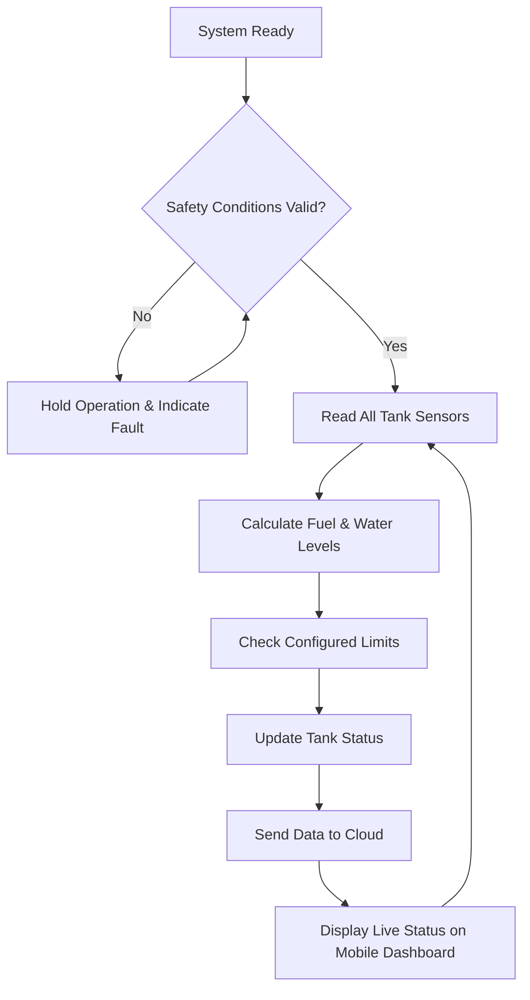

# ⛽ Filling Station Automation System

  <strong>A cloud-connected industrial tank-monitoring system for live fuel and water-level visibility across a filling station.</strong>

> **Documentation status:** Project photographs are not currently available. This repository therefore presents a high-level engineering case study without publishing customer-confidential or reproduction-ready technical material.

---

## 📌 Project Overview

This project involved developing and integrating an automation and monitoring solution for a filling station. Every fuel tank was equipped with industrial-grade sensing equipment to measure the available fuel and detect the amount of water present in the tank. Each tank operated with configured measurement limits, and the complete system was connected to the cloud for centralized, live monitoring.

The system used **ESP32 and Arduino-based embedded control**, a **custom main-control PCB**, industrial sensor interfaces, and cloud connectivity. Its purpose was to give the station owner a practical view of tank conditions and system status from a mobile phone while supporting reliable operation in an industrial environment.

## 👨‍💻 My Engineering Contribution

- Developed the embedded control sequence and operating logic
- Designed the custom main-control PCB
- Selected and sourced industrial-grade level-sensing equipment and supporting hardware
- Integrated fuel-level and water-level measurements for every monitored tank
- Implemented configurable measurement limits and status handling
- Connected the embedded system to the cloud for live data monitoring
- Enabled mobile access so the owner could review tank and system status remotely
- Supported electrical assembly and on-site installation
- Performed functional testing and troubleshooting
- Assisted with system commissioning and final validation

## ⚙️ Conceptual System Architecture

```mermaid
flowchart LR
    A[Industrial Sensors on Every Tank] --> B[Fuel & Water-Level Measurements]
    B --> C[Signal Conditioning & Interfaces]
    C --> D[Custom Main-Control PCB]
    D <--> E[ESP32 & Arduino Control]
    E --> F[Limit & Status Processing]
    F --> G[Cloud Platform]
    G --> H[Live Monitoring Dashboard]
    H --> I[Owner's Mobile Phone]
```

This diagram is intentionally conceptual. It communicates the engineering structure without revealing exact wiring, component selection, addressing, logic, or production parameters.

## 🔄 High-Level Operating Workflow

## 🧩 Engineering Areas

| Area | Portfolio Scope |
| --- | --- |
| **Embedded control** | ESP32 and Arduino programming for sensor acquisition, status handling, limit checking, and cloud communication |
| **Custom electronics** | Main-control PCB design for system-level signal and control integration |
| **Industrial sensing** | Fuel-level and water-level measurement across all monitored tanks using industrial-grade equipment |
| **Cloud monitoring** | Centralized live reporting of tank measurements and system status |
| **Mobile visibility** | Remote access for the station owner through a phone-friendly monitoring interface |
| **Electrical integration** | Connecting field sensors, embedded controllers, the main-control PCB, and supporting industrial equipment |
| **Testing** | Sensor checks, limit validation, communication tests, and troubleshooting |
| **Commissioning** | On-site validation and preparation for practical operation |

## 🛡️ Reliability and Safety Approach

- Validate sensor readings before updating the reported tank status
- Check tank measurements against configured operating limits
- Identify invalid readings and sensor or communication faults
- Provide clear tank, operating, and fault-status feedback
- Verify each tank sensor individually before system-wide testing
- Separate control logic from high-power switching through appropriate interfaces
- Keep local monitoring logic functional even when cloud communication is unavailable

> This section describes general engineering principles only. It is not an operating procedure or a substitute for site-specific engineering, applicable standards, risk assessment, or qualified supervision.

## 🧪 Development Process

1. Reviewed the tanks, required measurements, operating limits, and field conditions
2. Defined the sensor inputs, measurement states, cloud data, and monitoring requirements
3. Designed the main-control electronics and interfaces
4. Developed and tested the ESP32 and Arduino measurement and communication logic
5. Integrated the industrial sensors across the monitored tanks
6. Conducted staged measurement, limit, connectivity, and fault-condition checks
7. Supported installation, troubleshooting, and commissioning

## 🖼️ Project Media

Project photographs may be added later when suitable non-confidential images become available.

## 🔒 Confidentiality and Design Protection

To protect the customer, installation, and original engineering work, this repository intentionally excludes:

- ESP32 and Arduino firmware and exact control logic
- Schematics, PCB layouts, Gerber files, and manufacturing data
- Wiring diagrams, terminal schedules, and cabinet layouts
- Exact sensor models, calibration values, tank details, and operating limits
- Cloud architecture, API details, dashboard source code, and deployment configuration
- Network configuration, passwords, addresses, and credentials
- Site identity, customer data, and commercially sensitive documents

This repository is a **portfolio overview**, not an installation guide or open-source industrial control package.

## 🧠 Skills Demonstrated

`ESP32` · `Arduino` · `Embedded Systems` · `Industrial Automation` · `PCB Design` · `Industrial Sensor Integration` · `Fuel & Water-Level Monitoring` · `Cloud Monitoring` · `IoT` · `Electrical Systems` · `Testing` · `Troubleshooting` · `Commissioning`

---

## 👨‍💻 Developed by

**H. K. Theviru Lakwan** 
Mechatronics Engineer · PCB Designer · IoT Developer · Entrepreneur

[LinkedIn](https://linkedin.com/in/theviru-lakwan-7758a41b8) · [GitHub](https://github.com/MrTheviru)

---

### Intellectual Property

© 2026 H. K. Theviru Lakwan. All rights reserved.

This repository is provided for portfolio and demonstration purposes. No permission is granted to copy, modify, reproduce, manufacture, distribute, sublicense, or commercially use the project designs, documentation, diagrams, or other original materials without prior written permission from the author.
